# WeftOS

[](https://github.com/WeftOS/weftos/releases)
[](https://crates.io/crates/weftos)
[](LICENSE)

WeftOS is an agent framework plus a cognitive OS layer, written in Rust. The
framework (`clawft`) gives you LLM providers, channels, tools, skills and the
`weft` agent CLI. The OS layer is a kernel with a process table, typed IPC, an
append-only audit chain (ExoChain) and constitutional governance. On top of it
sit a machine mesh, governed workload placement, and cogs: small signed
programs that run as workloads on the mesh. The operator CLI is `weaver`.

Use it to run agents as governed kernel processes, and to place small signed
programs (cogs) on the machines that have the hardware for them, with every
decision recorded. The current release is v0.8.4.

<!-- facts:start -->
- 65 workspace crates, 40 of them published to crates.io
- 123 architecture decision records
- 29 cogs in the Cogs repository, and 795 modules in the hardware catalog
<!-- facts:end -->

## Install

Each of these installs `weft` (agent CLI) and `weaver` (operator CLI). The
[installation guide](https://weftos.weavelogic.ai/docs/weftos/getting-started/installation)
has the details and the platform list.

```sh
# Release installer (Linux and macOS). Verifies each archive's sigstore
# attestation when the GitHub CLI is installed.
curl -fsSL https://raw.githubusercontent.com/WeftOS/weftos/master/scripts/install.sh | sh

# Homebrew (one formula per package: clawft-cli = weft, clawft-weave = weaver, weftos).
# Not working yet: available after the next tap update.
brew install weave-logic-ai/tap/clawft-cli
brew install weave-logic-ai/tap/clawft-weave

# Docker (linux/amd64 and linux/arm64).
# Not working yet: available after the first published image.
docker pull ghcr.io/weftos/weftos:latest

# crates.io: libraries and the kernel daemon. weft and weaver are not
# published there (publish = false).
cargo install weftos
```

Keep an install current with `weaver update`. It refuses any release whose
signed manifest does not verify; see [docs/deployment/install.md](docs/deployment/install.md).
Release archives for Linux, macOS and Windows are on
[GitHub Releases](https://github.com/WeftOS/weftos/releases). Rustdoc for the
published crates is on docs.rs, for example [docs.rs/clawft-kernel](https://docs.rs/clawft-kernel).

## First run

```sh
export OPENAI_API_KEY="sk-..."           # or configure another provider, or a local model

weaver kernel start                      # start the per-project kernel daemon
weaver kernel status
weft agent -m "Summarize this project"
weft agent --local -m "Summarize this project"   # no daemon: run in-process
```

The [quickstart](https://weftos.weavelogic.ai/docs/weftos/getting-started/quickstart)
walks through `weftos init`, configuration and your first project.

## How the pieces fit

### Two layers



The top layer is the agent framework: providers, channels, tools, skills and the
`weft` CLI. The bottom layer is the kernel, operated with `weaver`. An agent
started from `weft` runs as a process in the kernel's process table and talks
to other processes over typed IPC. Governance decides actions, and the ExoChain
records decisions as an append-only chain. See
[Kernel and architecture](https://weftos.weavelogic.ai/docs/weftos) for each part.

### A cog's life



1. A cog is released as a signed package: an Ed25519 signature, one binary per
   architecture and its `cog.toml` manifest.
2. It is verified against a pinned key before it is trusted. An unsigned or
   wrongly signed cog is refused.
3. Governed placement filters nodes by hard constraints, scores the survivors,
   and needs a governance permit for `workload.place`.
4. The node runs it. The Cog Host supervises it; native placement needs a node
   trust tier of at least `paired`.
5. The cog publishes on cogbus as readings, streams or blobs.
6. A topic is local to its node until an operator exposes it to an audience.
   `weaver expose off` withdraws it at once.

Every placement decision, refusal and revocation is an ExoChain event. Details:
[cogs](https://weftos.weavelogic.ai/docs/weftos/platform/cogs),
[placement](https://weftos.weavelogic.ai/docs/weftos/platform/placement),
[cogbus](https://weftos.weavelogic.ai/docs/weftos/platform/cogbus). The cogs
themselves live in [WeftOS/weftos-cogs](https://github.com/WeftOS/weftos-cogs).

### The mesh


Nodes connect over encrypted links (Noise, on TCP, WebSocket or QUIC). After the
handshake a peer sends a signed `AdmitHello` that binds its node id to its
Ed25519 key. Admission has three modes: `off`, `observe` (the default) and
`enforce`, which refuses unadmitted peers. What a node offers is an exposure:
nothing is exposed by default, the audience is `local` until the operator widens
it, and the operator can always switch it off. See
[mesh networking](https://weftos.weavelogic.ai/docs/weftos/mesh-networking) and
[exposures](https://weftos.weavelogic.ai/docs/weftos/platform/exposures).

The [tailnet router](https://weftos.weavelogic.ai/docs/weftos/platform/tailnet-router)
is separate from the mesh: one HTTPS front door per development machine, over
Tailscale Serve, routing by path prefix to each project's own port. It is
tailnet-only and never enables Funnel.

## Status

What is built in v0.8.4, from the platform pages. "Proposed" is the decision
record's status, not a promise of a date.

| Area | Decision record | Status |
|---|---|---|
| Cog workload kind, cog sources | ADR-100, ADR-105 | Accepted |
| Governed placement | ADR-099, ADR-101 | Accepted |
| Cogbus (cog data plane) | ADR-122 | Accepted, built in 0.8.4 |
| Mesh transport, Noise, admission | ADR-103 | Built in the 0.8.4 daemon |
| Exposures and the local kill switch | ADR-120 | Proposed, partly built |
| Tailnet router | ADR-116 | Proposed, routes and allowlists shipped |
| Seed licence proxy | ADR-106 | Proposed, partly built |
| Signed updates (`weaver update`) | none, see the docs page | Shipped, fails closed |

Not built yet: a compiled-in WeftOS signer set (every accepted package signature
comes from an operator-pinned key), WASM execution for cogs, and landlock and
seccomp isolation for native cogs.

## Documentation

| Where | What |
|-------|------|
| [Getting started](https://weftos.weavelogic.ai/docs/weftos/getting-started) | Install, quickstart, first project |
| [Platform](https://weftos.weavelogic.ai/docs/weftos/platform) | Cogs, cog data plane, placement, exposures, licence proxy, project topology, tailnet router, chief of staff, voice, signed updates |
| [CLI reference](https://weftos.weavelogic.ai/docs/clawft/cli-reference) | Generated `weft` and `weaver` command references |
| [Kernel and architecture](https://weftos.weavelogic.ai/docs/weftos) | Boot, process table, IPC, ExoChain, governance, mesh, ECC |
| [Architecture decisions](docs/adr/README.md) | ADR index: what was decided, when, and its status |
| [Cogs repository](https://github.com/WeftOS/weftos-cogs) | The cogs, the Cog Host, the catalog and the cog product docs |
| [API docs](https://docs.rs/weftos) | Rustdoc for the published crates on docs.rs |

Repository-side references live in [docs/reference/](docs/reference/) (CLI,
config, RPC, tools, capability vocabulary). The site sources are in
`docs/src/`; run `npm ci && npm run dev` there to preview it.

## Build from source

Rust 1.95 or newer (`rust-toolchain.toml`) and Node.js 18+ for the site.
Use `scripts/build.sh` rather than raw cargo.

```sh
git clone https://github.com/WeftOS/weftos.git
cd weftos
scripts/build.sh native          # release build
scripts/build.sh native-debug    # fast iteration
scripts/build.sh test            # workspace tests
scripts/build.sh clippy          # lint, warnings as errors
scripts/build.sh gate            # full phase gate
scripts/build.sh --help          # all commands
```

Browser (`wasm32-unknown-unknown`) and WASI (`wasm32-wasip2`) targets have their
own lanes, `scripts/build.sh browser` and `scripts/build.sh wasi`. The browser
guides are in [docs/browser/](docs/browser/); see also
[ADR-083](docs/adr/adr-083-browser-wasm-support.md) and
[ADR-044](docs/adr/adr-044-wasm-wasip2-target.md).

## Contributing

See [CONTRIBUTING.md](CONTRIBUTING.md). Run `scripts/build.sh gate` before
submitting a pull request, and follow the
[kernel developer guide](docs/src/content/docs/weftos/kernel-guide.mdx).

## Security

Report a vulnerability through a private advisory at
<https://github.com/WeftOS/weftos/security/advisories/new>, not a public issue.
See [SECURITY.md](SECURITY.md).

## License

The workspace crates declare `MIT OR Apache-2.0` in `Cargo.toml`. The
repository's [LICENSE](LICENSE) file is the MIT text.

## Attribution

WeftOS builds on ideas and patterns from
[claude-code](https://github.com/anthropics/claude-code),
[claude-flow](https://github.com/ruvnet/claude-flow) and
[ruvector](https://github.com/ruvnet/ruvector). The kernel draws on microkernel
OS design (L4, seL4), capability-based security (Capsicum) and distributed
systems research (SWIM, Raft, CRDTs, Kademlia).
