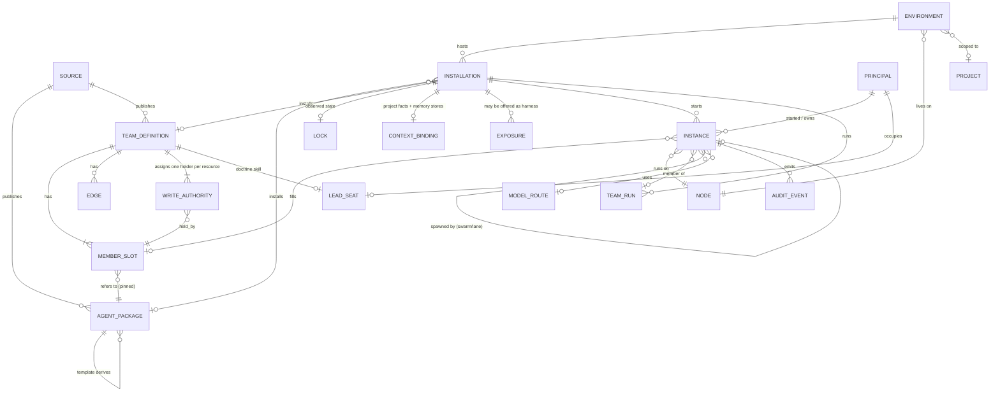
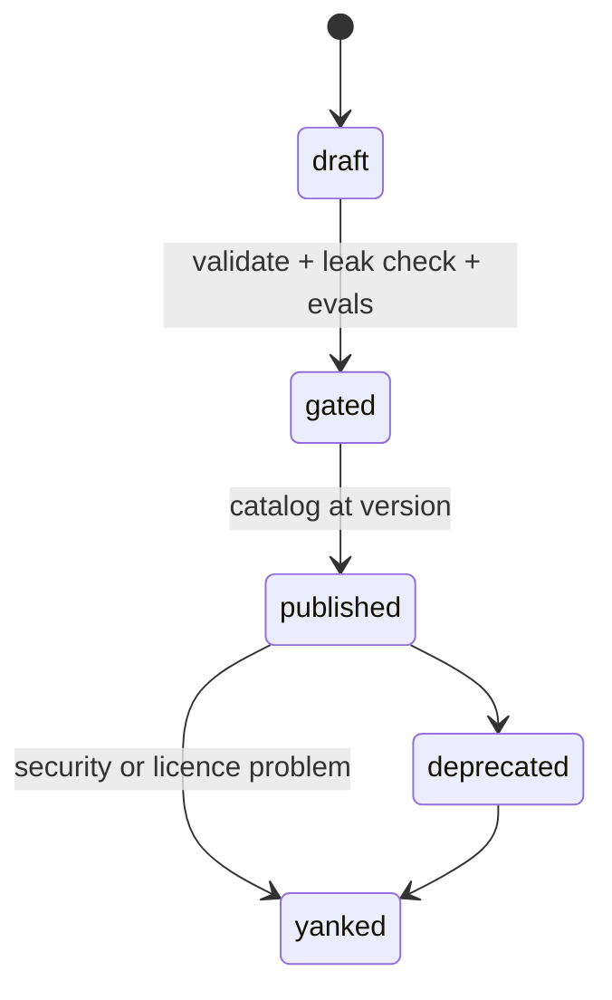
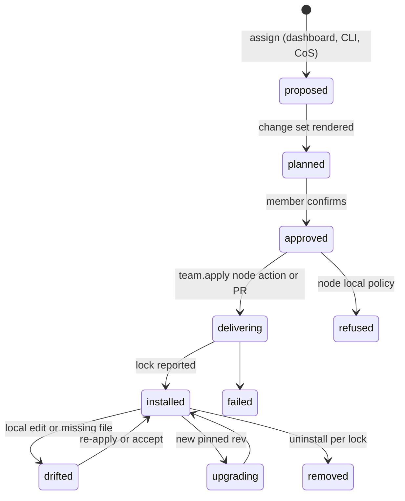
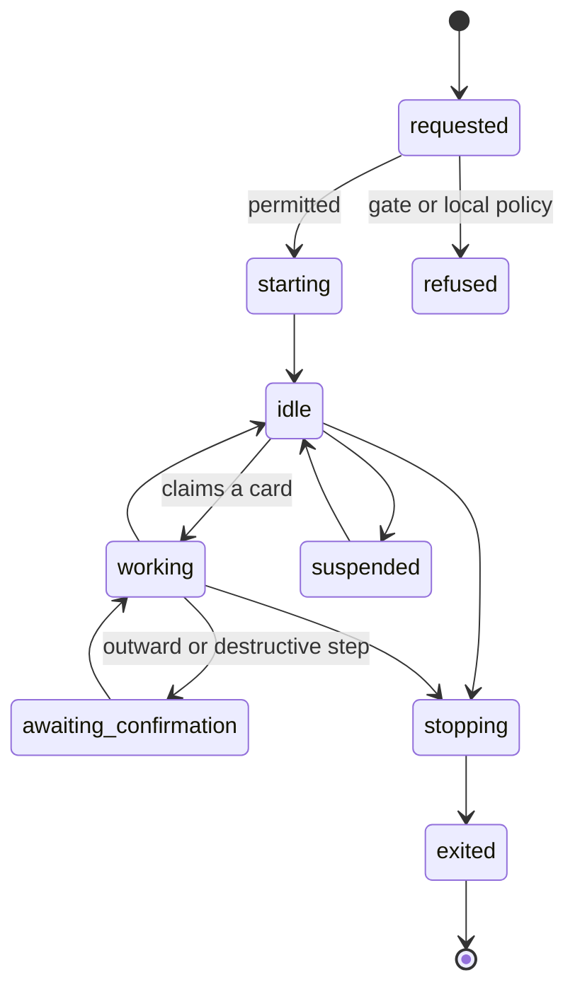

# AI org: the domain model

- **Status**: Draft (2026-10-11), for owner review. Not an ADR yet; the owner questions in §9
  decide what becomes one.
- **Owner ask (2026-10-11):** "AI org is complicated, it needs to handle both OS level agents but
  then agents as groups, and agents installed as packages etc into environments."
- **Builds on**: the Agent Directory decision
  (`docs/research/agent-directory/adr-draft-agent-directory.md`, AD-1..AD-23), ADR-099
  (placement, `workload.ctl`), ADR-101 (inference roles), ADR-108 (projects on many machines,
  node actions), ADR-109 (agent environment profiles), ADR-110 (transcripts), ADR-112 (teams:
  define, apply, run; TM1-TM6), ADR-114 (`weftos://` names), ADR-118 (chief-of-staff console),
  ADR-120 (mesh resources and exposures).
- **Partner doc**: the AI org page design (aiorg-designer) builds on this model.

## 1. The problem in one paragraph

"Agent" currently means four different things in WeftOS: a package in `agents/` (a file tree
with an `AGENT.md`), a row the dashboard draws on the org chart, files `weftos init` wrote into
a project for Claude, Codex or Grok, and a process or session that is actually running (the
kernel's agent loop, the chief-of-staff host, a lane spawned for one card). Teams have the same
four meanings. The AI org page cannot be built until these are separate things with separate
states, so this model splits them along one spine:

> **Definition → Installation → Instance**, and for groups
> **Team definition → Team installation → Team run**.

OS-level agents are not a fifth thing: they are installations whose source is the WeftOS
release and whose environment is the node daemon (§3.8).

## 2. Entity diagram

Read it as three layers: what can be installed (top), where it is installed (middle), what is
running (bottom). Every arrow downward is a pin: an installation pins a definition by digest;
an instance pins the installation it came from.

## 3. Definitions

### 3.1 Agent package (definition)

The authored, versioned, installable unit. Lives at `agents/<id>/` (`AGENT.md` or `SKILL.md`,
`skills/`, `evals/`, `weftos-package.yaml`) and is listed in the generated `agents/catalog.json`.

| Field | Source today | Notes |
|---|---|---|
| `id`, `name`, `nickname`, `role`, `description` | catalog | `name` = `id` today |
| `kind` | catalog | `specialist`, `lane`, `skill` (doctrine, never spawnable: `lead-doctrine`), `template` |
| `trust_tier` | catalog | `core`, `internal`, `template` appears for templates today (see §7) |
| `capabilities` | sidecar | e.g. `board_write`, `memory_write`, `read_only_measurement` |
| `skills`, `requires` | catalog | skill packages it loads |
| `hosts[]` | catalog | `claude`, `grok`, `codex` |
| `required_project_context` | sidecar | keys an installation must bind (§3.5) |
| `secrets` | sidecar | names and descriptions only, never values |
| `provenance` | catalog | source registry, licence, verdict `adopt/adapt/pattern/build` |
| `version` | catalog top level | the weftos release (`0.8.4-rc.6`) |
| `digest` | missing | needed for `?rev=sha256:` pins (ADR-114 §4) |

A package holds **method only**: no project facts, no memory, no client names (ADR-112 §6,
enforced by `scripts/agents-leak-check.sh`, gate checks AD-1/AD-2 in `scripts/build.sh`).

**Templates** (`domain-expert`, `model-domain-expert`, `external-system-reader`) are definitions
of definitions: instantiating one produces a **derived package** filled with one project's
domain, which lives in that project's private `weftos-<slug>` repo and never in the public
catalog. The derived package records which template and revision it came from.

### 3.2 Team definition

`agents/teams/<id>/team.yaml`, team spec v1 (ADR-112 §1, `agents/teams/SCHEMA.md`). A team is
not a list of agents; it is a list of **member slots** plus the rules that bind them:

- **Member slot**: package ref (`id@version`), nickname, position, `one_job`, `model_tier`
  (`top`/`mid`/`small`), optional tool allow-list (narrows only), `authority`
  (`autonomous`/`supervised`/`escalated`), `owner` (a human role slug, never a name),
  `must_not[]`, readable confidentiality `tiers[]`, `active` / `phase`.
- **Edges** between slots: `delegates_to`, `consumes` (producer to steward, findings to docs
  owner, lessons to the memory router), `consults` (advisory, never blocking).
- **Write authority**: each shared resource (`board`, `card_history`, `memory`, `docs`, `code`,
  `production_read`) has exactly one holder. The gate refuses zero or two.
- **Team rules**: eight named, testable rules rendered into each host's instruction files.
- **Presets**: declared variants only (`full`, `lean`, `codex-review`).
- **Hosts**: tool-name map per host.
- **Lead seat**: the lead is a doctrine skill (`lead-doctrine`) loaded into the main,
  human-driven session. It is a seat a principal occupies, never a spawned member.

The same package can fill slots in several teams with different `one_job`, tier and authority.
That is why the old `reports_to` on a package (dashboard `agents.reports_to`) is the wrong
place for structure: reporting lines are team edges.

**The owner's team** is `weftos-core`: chief of staff (CoS), Stew, Doc/Gus, Liber, Mo,
developer, reviewer, tester active; documenter and measurer inactive until phase 2. It is the
owner's own team, deployable to any project, and carries no memory between projects.

### 3.3 Source

Where definitions come from, and what trust they start with:

| Source | Holds | Visibility |
|---|---|---|
| WeftOS public `agents/` | core packages, `weftos-core`, templates | public, in `catalog.json` |
| A project's private `weftos-<slug>` repo | derived packages, project or client teams | private to that workspace, never published |
| Signed bundle (TM6) | a team or package, content-addressed, signed with the WeftOS release key | by `weftos://<mesh>/teams/<id>?rev=…` |
| Upstream registry (provenance only) | where an adopted package came from | recorded in `provenance`, never fetched at install |

### 3.4 Environment

The place an installation lands. Three scopes, each with one or more **host runners**
(`claude`, `codex`, `grok`, and `weftos` for the daemon itself):

| Scope | What it is | Who writes it | Today |
|---|---|---|---|
| `project` | a project workspace on one machine (ADR-108 installation: project x host) | `weftos init --team … --apply`, later the `team.apply` node action | built (TM2 in progress) |
| `node` | the user daemon / OS service on a node | the WeftOS install itself | implicit, unmodelled |
| `machine` | user-global host config (`~/.claude`, `~/.codex`, `~/.grok`) | ADR-109 doctor apply, after consent; `weftos init --global` by hand | built for hand use only |

ADR-112 §2 forbids team apply writing user-global files. The model keeps `machine` as a scope
so the AI org page can **show** what is installed globally (from the doctor report), but
writing it stays an ADR-109 doctor action.

### 3.5 Installation

One definition (package or team, pinned) placed into one environment for a set of hosts.

- **Desired**: definition `@rev`, preset, hosts, overrides, who asked.
- **Context binding**: the installation's `project-context.md` values: board adapter, docs
  root, card-history root, **memory store**, confidentiality tiers. This is where facts and
  memory attach. Two installations of the same team share nothing.
- **Observed**: the lock (`.weftos/agents.lock.json`: renderer, weftos version, commit, team,
  per-agent per-file SHA-256 and merge mode), drift (local edits, missing files), birth report
  (adapters bound, keys missing), collision report.
- **Delivery**: a node action (`team.apply`, ADR-112 §3) to the machine holding the workspace,
  or a PR for projects without a node (AD-7).

### 3.6 Instance

One running agent: a host session, a daemon task, or a headless job.

| Field | Meaning |
|---|---|
| `instance_id` | opaque, per run |
| `installation`, `slot` | where it came from; a slot only when started as a team member |
| `runner` | `host-session` (Claude/Codex/Grok CLI), `daemon` (kernel `AgentSupervisor`, `SpawnBackend` native/wasm/container/remote), `harness-job` (headless, through `workload.ctl`) |
| `node`, `project` | where and for whom it runs |
| `principal` | the human (or parent instance) that started it |
| `identity` | kernel `agent_id` + Ed25519 key (`clawft-kernel::agent_registry`), registered on the chain |
| `model` | actually in use, resolved from the slot's tier (§4.1) |
| `work` | current card or task, claim status |
| `state` | §6.3 |
| `transcript` | ADR-110 reference, partitioned by project |
| `parent` | the instance that spawned it (lane fan-out, `SwarmCoordinator`) |

Instances are cheap and short: lanes recycle after one bounded task, continuity lives in the
handoff document and the project's stores, not in the instance.

### 3.7 Groups at runtime: team run, swarm

- **Team run**: `weaver team up <team> --project <ULID>` (ADR-112 §4, TM5): the instances of
  one team installation, supervised by the user daemon, talking on the WeftOS agent bus. It
  has its own state (up, degraded, down) and shows who holds which card. Not built.
- **Swarm / lane fan-out**: an ad-hoc group of instances spawned by a parent instance for one
  task (`clawft-core::agent_bus::SwarmCoordinator`, flat topology only). It has no definition
  and no installation; it is visible only as parent-child links between instances. The ruflo
  coordinator names (`hierarchical-coordinator` etc.) are prompt roles, not WeftOS types.
- **Roles and leads**: a role is a slot (`one_job`, `owner` role, authority). A lead is the
  lead seat. Neither is a separate runtime entity.

### 3.8 OS agent

An agent that is part of WeftOS rather than added to a project. In this model it is an
**installation with `source = weftos release` and `scope = node`** (runner `weftos`), so it
gets the same instance, model, audit and governance treatment as everything else. What
differs:

- it is versioned with the weftos binary, not pinned per project;
- it is **enabled or disabled** per node, never uninstalled by a team apply;
- its memory, if any, is bound to a principal or node scope, not a project (owner question 6).

Current OS agents:

| Agent | Code | Notes |
|---|---|---|
| Kernel agent loop (`agent.chat`) | `clawft-service-agent` over `clawft-core::agent::AgentLoop` | per-conversation instances, the daemon's general agent |
| Voice talk agent | `clawft-voice-talk`, `clawft-channels` talk mode | interactive latency class (ADR-101) |
| Chief-of-staff host | `crates/weftos-cos` (`weftos-cos serve`, loopback `:18300`) | **hybrid**: its method is also the catalog package `chief-of-staff` and the `weftos-core` member CoS |
| Kernel-spawned agents | `AgentSupervisor` processes | any installation can run here as runner `daemon` |

CoS shows why OS agents must not be a separate species: the same definition is installed
both as a node-scope OS agent (the console's agent) and as a project-scope team member.

### 3.9 Exposure

ADR-120 §3: an installation or team can be offered to other nodes as an exposure of kind
`harness` (`harness.<id>`), with audience, limits, state (`on`/`off`/`paused`/`refused`) and a
chained activity log. Starting it is a governed `workload.ctl` request. An exposure is an
attribute of an installation, not a new kind of agent.

## 4. Cross-cutting attachments

### 4.1 Models

- The **slot** declares a tier (`top`/`mid`/`small`); the **installation** (or node default)
  maps tiers to routes; the **instance** records the model it actually used.
- Routes are either an ADR-101 inference role (`infer.<role>`, local or placed on a peer) or a
  frontier provider id. CoS already does this per turn (`weftos-cos::routing`, `quick` vs
  `plan`).

### 4.2 Skills and tools

Package `skills` and `capabilities` define what is possible; the slot's tool allow-list
narrows it; the host `tool_map` renders names per host; at spawn the kernel enforces
`AgentCapabilities`. Write capabilities must match the team's write-authority table (TM1 gate).

### 4.3 Memory

- **Bound on the installation, never on the definition or the instance.** Apply creates the
  project's own stores and binds them in `project-context.md`; Liber routes into them, Doc/Gus
  writes card history there.
- **Nothing travels.** Installing a team in a new project copies no memory, history, card
  files, corpus or learned patterns (ADR-112 §6).
- An agent owns no memory. Stores belong to a project, or for OS agents to a principal or node
  scope. Memory is addressed as `weftos://<mesh>/memory/<store>` (ADR-114 N4).

### 4.4 Governance and permissions

| Level | Control |
|---|---|
| Definition | trust tier, declared capabilities, secret names, provenance, gate status |
| Slot | authority, `must_not`, readable tiers, tool narrowing |
| Team | write authority (one holder per resource), team rules, declared presets only |
| Installation | consent before apply; project-scoped writes only; signed, pinned source (TM6) |
| Instance | permissions passed per launch (no global settings, no bypass); confirmation turn before outward, destructive or production actions; kernel capabilities |
| Exposure | audience, limits, local switch wins (ADR-120 §4) |

A `weftos://` name never grants anything (ADR-114 §3).

### 4.5 Audit

| Event | Where |
|---|---|
| catalog sync, assignment, change set, delivery, install, drift, upgrade, removal | dashboard `agent_events` |
| identity registered, spawn, stop | chain (`agent.registered`, supervisor events) |
| remote start, exposure request | chain (`workload.ctl`, exposure activity log) |
| tool calls and turns | ADR-110 transcripts, CoS tool events (redacted) |
| file state | the installation lock |

## 5. Names

| Thing | Name |
|---|---|
| Package | `weftos://<mesh>/agents/<id>?rev=sha256:…` |
| Team definition | `weftos://<mesh>/teams/<id>?rev=sha256:…` |
| Installation | `weftos://<mesh>/installations/<uuid>` (already a kind; extend from project x host to agent installs, or add a sub-resource) |
| Instance | open: ADR-114 says `agents` covers "registered or running agents", which collides with packages (owner question 3) |
| Memory store | `weftos://<mesh>/memory/<store>` |

## 6. Lifecycles

### 6.1 Definition

### 6.2 Installation

OS installations use only `enabled` and `disabled`.

### 6.3 Instance

`exited` carries an outcome: `done`, `recycled`, `failed`, `stopped`. This maps onto the kernel
`ProcessState` (`Starting`, `Running`, `Suspended`, `Stopping`, `Exited(code)`); `idle`,
`working` and `awaiting_confirmation` are sub-states of `Running` that the agent reports.

## 7. How today's pieces map onto the model

| Model entity | WeftOS today | Dashboard today | Gap |
|---|---|---|---|
| Package | `agents/<id>/`, `catalog.json` (`id`, `name`, `nickname`, `kind` specialist/lane/skill/template, `hosts[]`, top-level `version`) | `lib/agentCatalog.ts` expects `slug`, `aliases`, `reports_to`, `build_status`, `integration_state`, per-agent `version` object with digest; `agents.kind` check allows `lead_doctrine` not `skill` | **shape drift**: the dashboard must read the new shape; catalog needs a per-package digest |
| Catalog fetch | generated by `scripts/build.sh agents-catalog` | `app/api/agents/catalog/route.ts` fetches from the `0.8-metaharness` branch, falls back to a fixture | wrong branch; no private-source catalog |
| Template / derived package | `agents/templates/*` | none | no record of instantiation |
| Team definition | `team.yaml` spec v1, `catalog.json` `teams[]` with full slot fields | `agent_teams` + `agent_team_members` (`position`, `pin` only) | slot fields, edges, write authority, presets not stored or shown |
| Legacy agents | `agents/weftos/*.md` (12 agents: kernel-architect … doc-weaver) | not shown | not packages, not in catalog (owner question 5) |
| Environment | project workspace only, via `weftos init` | `project_agent_assignments` (project only, hosts limited to claude/grok/codex) | no node or machine scope, no `weftos` runner |
| Installation (desired) | none | `project_agent_assignments` (`draft` … `installed`, `removed`) | fits; add environment scope |
| Installation (proposed) | renderer in `weftos init --plan` | `agent_changesets`, `agent_changeset_items` | fits |
| Installation (observed) | `.weftos/agents.lock.json` | `project_agent_locks`, `/api/harness/agents/report` | **nothing in weftos posts to the harness agent routes**; `team.apply` node action not built |
| Instance | kernel `AgentRegistry` (in-memory identities), `AgentSupervisor` processes, `clawft-service-agent` conversations, CoS host, host CLI sessions (invisible) | none | no instance record, no report section, identities not linked to package ids |
| Team run | not built (TM5) | none | |
| OS agent | `weftos-cos`, `clawft-service-agent`, voice crates | none | unmodelled |
| Exposure (harness) | ADR-120 Proposed, X4 | none | |
| Models | slot `model_tier`; CoS quick/plan routing; ADR-101 roles | none | tier-to-route mapping per installation not stored |
| Memory binding | `project-context.md` | none | not reported |
| Audit | chain, transcripts, lock | `agent_events` | no instance events |

## 8. What to build, in order

1. **Read the catalog as it is.** Dashboard catalog types follow the generated shape; the
   catalog gains a per-package digest and the route reads the release branch. (Unblocks the
   page.)
2. **Store team slots.** Extend `agent_team_members` (or store the slot JSON) so the page can
   show one-job, tier, authority, owner role and edges; draw the org from team edges.
3. **Environment scope on installations.** Add `scope` (`project`, `node`, `machine`) and the
   `weftos` runner to assignments; OS agents appear as `node` installations.
4. **Report installed and running.** A compact `report.agents` section in the daemon report:
   installations (lock digest, drift counts) and instances (id, package, slot, model, state,
   card; no content), within the 60 KB budget. The daemon posts locks to the existing harness
   route or folds them into the report.
5. **`team.apply` node action** (TM3), then the team run (TM5) and harness exposures (ADR-120
   X4).

## 9. Decisions only the owner can make

| # | Question | Recommended default |
|---|---|---|
| 1 | Are OS agents catalog packages like everything else, or a separate system class? | Packages. An OS agent is a package installed by the release at `node` scope, enabled or disabled per node. CoS already works this way. |
| 2 | Which environments may the dashboard install into? | `project` (TM2/TM3) and enabling or disabling `node` OS agents. `machine`-global stays an ADR-109 doctor action, shown but not written by team apply. |
| 3 | What does `weftos://…/agents/<id>` name: the package or a running agent? | The package, pinned by `rev`. Running instances get their own kind (`instances`) when needed; until then they are not addressable by name. |
| 4 | Who sits at the top of the org view? | The human principal, then CoS as first report, then the team via `delegates_to` edges. Drop `reports_to` from packages. |
| 5 | The 12 legacy `agents/weftos/*.md` agents: package them or retire them? | Retire them from the AI org until someone packages one; keep the files as reference. |
| 6 | Do OS agents (CoS) keep memory of their own? | No agent-owned memory. CoS notes go to project history; owner preferences, if any, go to a principal-scope store bound at node install. |
| 7 | Should the daemon report running instances to the dashboard? | Yes, as a summary only (ids, package, slot, model, state, card), never transcript content. |
| 8 | May the dashboard start agents or teams, or only see and stop them? | See and stop. Starting is a queued node action that the node confirms locally (consistent with ADR-120 question 3). |
| 9 | Does the dashboard show private catalogs (a workspace's `weftos-<slug>` packages and teams)? | Yes, merged with the public catalog and labelled by source, visible only inside that workspace. |

## 10. Not decided here

The page layout (aiorg-designer's doc), the instance table schema, and the agent bus protocol
for team runs (TM5).
